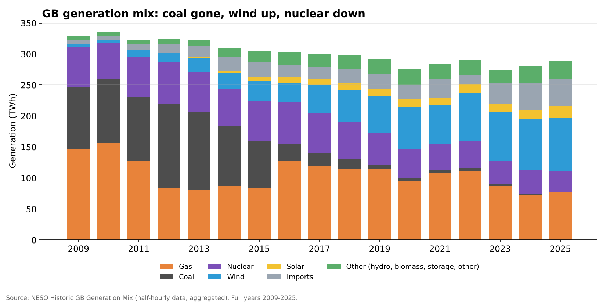
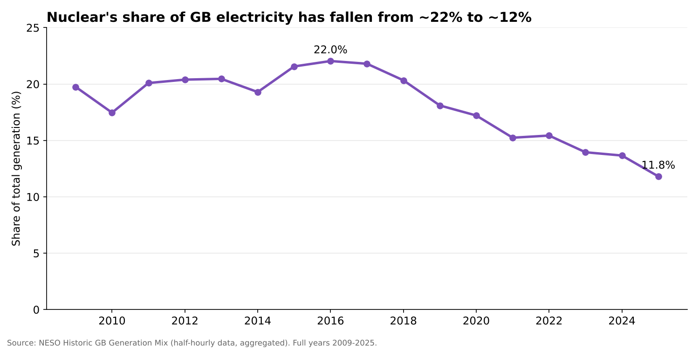
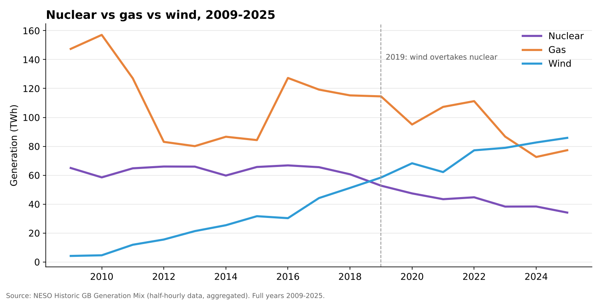
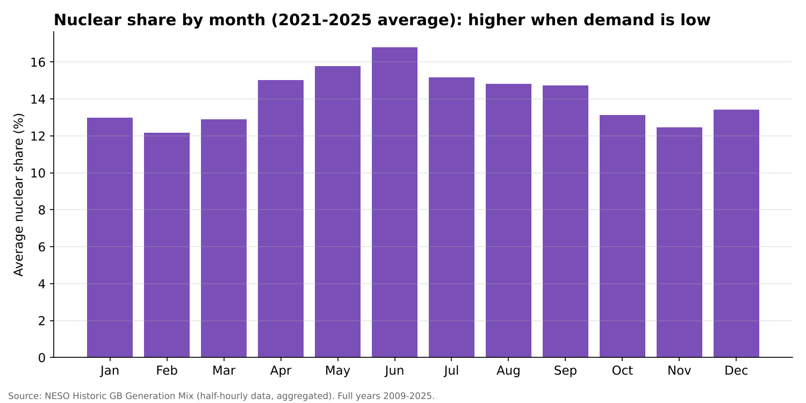

# UK Electricity Generation Analysis: Nuclear's Role in the Grid (2009–2025)

An end-to-end data project analysing **17 years of Great Britain's electricity generation** to understand how the role of nuclear power has changed as coal closed and renewables grew.

**Tools:** Excel (SUMIFS, AVERAGEIFS, COUNTIFS, charts) · SQL (SQLite) · Python (pandas, matplotlib)



---

## Questions

1. How much electricity has nuclear generated each year, and what share of the total?
2. How has the generation mix changed?
3. How does nuclear compare with gas and wind over time?
4. Is nuclear's share seasonal?

---

## Key findings

| | 2009 | 2016 | 2025 |
|---|---|---|---|
| Nuclear generation | 65.0 TWh | 66.8 TWh | **34.2 TWh** |
| Nuclear share | 19.7% | 22.0% | **11.8%** |
| Coal share | 30.0% | 9.2% | **0.0%** |
| Wind share | 1.3% | 10.0% | **29.7%** |
| Avg carbon intensity | 445 g/kWh | 274 g/kWh | **127 g/kWh** |

1. **Nuclear output roughly halved.** Nuclear generated a steady 60–67 TWh a year from 2009 to 2018, then fell every few years to 34 TWh in 2025. Its share of generation dropped from a peak of **22.0% (2016)** to **11.8% (2025)**.
2. **Coal disappeared.** Coal went from 30% of generation in 2009 (and 42% in 2012) to effectively zero in 2025.
3. **Wind overtook nuclear in 2019** and is now the largest single source in some years, generating 85.8 TWh in 2025, more than gas (77.3 TWh).
4. **The grid got much cleaner.** Average carbon intensity fell by around 70%, from 445 to 127 gCO2/kWh.
5. **Nuclear matters most in summer.** Between 2021 and 2025, nuclear's share peaked in **June (16.8%)** and was lowest in **February (12.2%)**. Nuclear output stays fairly steady through the year, but demand is lower in summer, so the same output covers more of it.
6. **Imports have grown** from 2% to over 15% of supply, partly filling the gap left by coal and nuclear.





---

## Data

- **Source:** [NESO Data Portal: Historic GB Generation Mix](https://www.neso.energy/data-portal/historic-generation-mix) (National Energy System Operator).
- **Raw data:** 312,816 half-hourly records from 1 January 2009 to November 2026, with generation by source in MW.
- **Coverage:** Great Britain (England, Scotland, Wales). Northern Ireland is a separate grid.

| File | Description |
|---|---|
| `data/gb_generation_monthly_raw.csv` | Monthly totals aggregated from the half-hourly data |
| `data/gb_generation_monthly_clean.csv` | Cleaned data: 214 complete months with derived fields |
| `data/gb_generation_annual.csv` | Annual totals and shares, 2009–2025 |
| `data/energy.db` | SQLite database used for the SQL analysis |

---

## Process

### 1. Aggregate and validate: `scripts/aggregate_half_hourly.py`
- Checked the 312,816 half-hourly rows for bad dates, duplicate timestamps, blanks and negative values. None were found.
- Converted power to energy: **MW × 0.5 hours = MWh**, then summed by month and converted to GWh.

### 2. Clean: `scripts/clean_data.py`
- Renamed columns with units (`NUCLEAR` → `nuclear_gwh`).
- Added `year`, `month_num` and `season`.
- **Completeness check:** compared half-hour intervals per month against the expected number (days × 48), and **removed November 2026**, which only had 4 days of data.
- **Reconciliation check:** confirmed that all sources add up to NESO's total for every month (maximum difference 0.2 GWh).
- Combined transmission wind and embedded (local) wind into a single wind total.
- Loaded the clean data into SQLite.

### 3. Analyse in Excel: `analysis/uk_energy_analysis.xlsx`
- **Annual_Summary:** yearly totals and shares built with `SUMIFS`, plus charts.
- **Seasonality:** monthly averages with `AVERAGEIFS`. Change the year range (blue cells) and it recalculates.
- **Data_Checks:** automated quality checks with `COUNTIFS` and `SUMPRODUCT`.
- **Cleaning_Log:** every cleaning step and the reason for it.

### 4. Analyse in SQL: `sql/analysis.sql`
Seven queries using `GROUP BY`, `HAVING`, `CASE WHEN` and aggregate functions. For example, the year wind first beat nuclear:

```sql
SELECT year,
       ROUND(SUM(wind_total_gwh) / 1000, 1) AS wind_twh,
       ROUND(SUM(nuclear_gwh) / 1000, 1)    AS nuclear_twh
FROM monthly_generation
GROUP BY year
HAVING COUNT(*) = 12 AND SUM(wind_total_gwh) > SUM(nuclear_gwh)
ORDER BY year
LIMIT 1;
-- Result: 2019 | 58.4 | 52.8
```

### 5. Visualise: `scripts/make_charts.py`
Four charts created with matplotlib, saved in `charts/`.

---

## Reproduce it

```bash
pip install pandas matplotlib openpyxl
python scripts/aggregate_half_hourly.py   # downloads the latest NESO data
python scripts/clean_data.py
python scripts/make_charts.py
python scripts/build_workbook.py
sqlite3 data/energy.db < sql/analysis.sql  # or open data/energy.db in DB Browser for SQLite
```

---

## Limitations and next steps

- Carbon intensity per year is an average of monthly averages, which is close to, but not exactly, the true annual figure.
- NESO's data is operational, so annual totals will differ slightly from official government statistics (DUKES), which use different coverage.
- **Next steps:** add electricity demand data, compare with plans for new nuclear capacity, and build an interactive Power BI dashboard.

---

*Author: [ArcSkt1](https://github.com/ArcSkt1) · CompTIA A+ · CompTIA Network+ · Studying AWS Cloud Practitioner*
